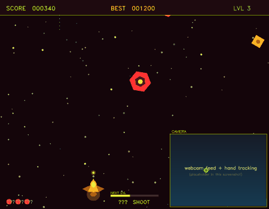
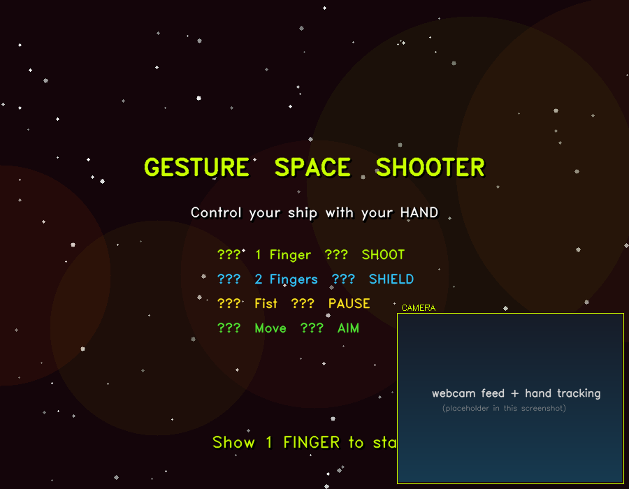
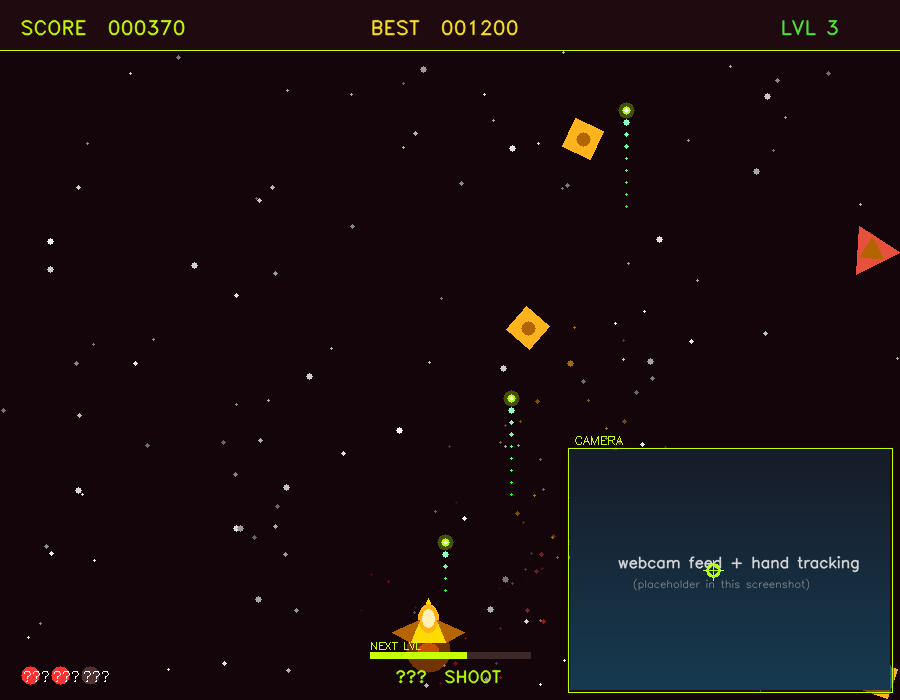
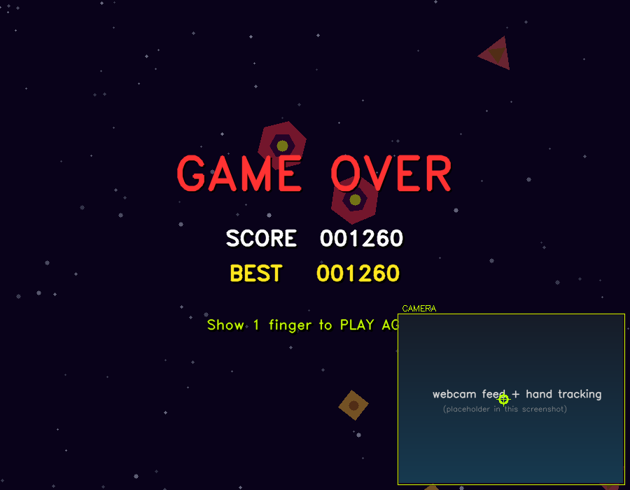
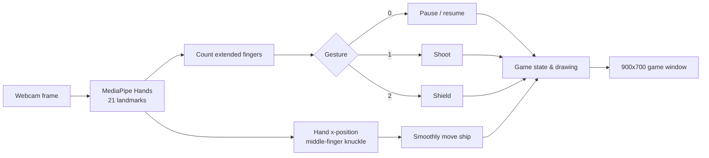

<div align="center">

# 🚀 Gesture Space Shooter

**Play a space shooter with your bare hand — no keyboard, no mouse.**
Built with Python, OpenCV and MediaPipe hand tracking.




<sub>Preview rendered by running the game's own logic with a scripted "hand" (no camera needed).
It shows the gameplay; the real game is controlled by your webcam.</sub>

</div>

---

## 🎮 About

Your webcam watches your hand. MediaPipe finds **21 landmarks** on it, the game counts how many fingers are up,
and that decides what your spaceship does. Move your hand to steer, raise fingers to shoot or shield,
and survive endless waves of enemies that get faster every level.

Everything runs in a **single Python file** ([`gesture_space_shooter.py`](gesture_space_shooter.py)) — no game engine, no assets to download.

---

## ✋ How to Play

| Gesture | Action |
|---|---|
| ✋ **Move your hand** left / right | Steer the spaceship |
| ☝️ **1 finger** | **Shoot** laser (also starts the game and restarts after Game Over) |
| ✌️ **2 fingers** | **Shield** — blocks one hit |
| ✊ **Fist** | **Pause / resume** |

**Keyboard (optional):** `Q` / `Esc` quit · `R` restart

### Rules
- You have **3 lives**. Colliding with an enemy costs one life — unless your shield absorbs it.
- The shield blocks **one hit** and **recharges every level**.
- Destroy enemies to score points. Every set number of kills you **level up** and enemies get faster and more numerous.

| Enemy | Shape | HP | Points |
|---|---|---|---|
| Type A | Triangle | 1 | 10 |
| Type B | Square | 2 | 20 |
| Type C | Hexagon | 3 | 35 |

Kills needed for the next level start at 10 and grow ×1.3 each level. Your best score is shown on screen while the game is running.

---

## 🖼️ Screenshots

<table>
<tr>
<td align="center"><br><sub>Start screen — show 1 finger to begin</sub></td>
<td align="center"><br><sub>Gameplay</sub></td>
<td align="center"><br><sub>Game over — show 1 finger to play again</sub></td>
</tr>
</table>

<sub>Screenshots are rendered by the game's own drawing code; the camera panel is a placeholder here.</sub>

---

## 🚀 Quick Start

You need **Python** and a **webcam**.

```bash
git clone https://github.com/bhanurajpoot04/gesture-space-shooter.git
cd gesture-space-shooter

python -m venv venv
venv\Scripts\activate            # Windows
# source venv/bin/activate       # Linux / macOS

pip install -r requirements.txt

python gesture_space_shooter.py
```

Allow camera access if your system asks, then **show 1 finger** to start.

### Tips for smooth tracking
- Sit in **good, even light** and keep your hand clearly in view.
- A **plain background** behind your hand helps a lot.
- Keep your hand about an arm's length from the camera.
- Show fingers clearly — a half-bent finger may not be counted.

---

## 🧠 How It Works



- **Finger counting:** a finger is "up" when its tip is above its middle joint (the thumb is compared sideways).
- **Steering:** the x-position of the middle-finger knuckle sets a target; the ship eases toward it (`lerp`) so movement feels smooth, not jittery.
- **Pause** uses a short debounce so one fist doesn't toggle pause many times.
- **Graphics** are drawn with plain OpenCV shapes (polygons, circles, glow overlays) on a NumPy array — no sprites.

### Code structure

| Class / function | Job |
|---|---|
| `GestureDetector` | Runs MediaPipe, counts fingers, outputs `shoot` / `shield` / `fist` / `none` |
| `Game` | Main loop, spawning, collisions, levels, HUD, splash / pause / game-over screens |
| `Ship` | Player ship and shield drawing |
| `Enemy` | Three enemy types with HP, speed, drift and hit flash |
| `Bullet` | Laser shot with a trail |
| `Particle` | Explosion effect |
| `Star` | Scrolling star-field background |

---

## ⚙️ Tweak the Game

Constants at the top of [`gesture_space_shooter.py`](gesture_space_shooter.py):

| Constant | Default | Effect |
|---|---|---|
| `WIN_W, WIN_H` | 900, 700 | Game window size |
| `CAM_W, CAM_H` | 320, 240 | Size of the camera panel |
| `FPS_CAP` | 60 | Frame-rate limit |
| `SHOOT_COOLDOWN` | 0.25 s | Time between shots |
| `ENEMY_BASE_SP` | 2.0 | Starting enemy speed |
| `MAX_LIVES` | 3 | Lives per game |
| `STAR_COUNT` | 120 | Background stars |

Other handy spots: `min_detection_confidence` in `GestureDetector` (lower = detects the hand more easily) and
`cv2.VideoCapture(0)` in `Game` (change `0` to `1` to use another camera).

---

## 🛠️ Troubleshooting

| Problem | Fix |
|---|---|
| `Cannot read from camera` | Close other apps using the webcam, or change `VideoCapture(0)` to `1` |
| Hand not detected | Improve lighting, plain background, move the hand into view |
| Wrong finger count | Spread fingers clearly; thumb counts only when it points sideways |
| `AttributeError: module 'mediapipe' has no attribute 'solutions'` | This game uses MediaPipe's classic `solutions` API. Install an older release: `pip install mediapipe==0.10.14` |
| `pip` cannot find `mediapipe` | MediaPipe supports a limited range of Python versions — use Python 3.10–3.12 |
| Game feels laggy | Close heavy apps, lower `FPS_CAP`, or lower the camera resolution in `Game.__init__` |

### Known limitations
- Emoji/symbols such as ♥ ☝ ✌ ✊ are **drawn as `?`** because OpenCV's built-in fonts cannot render them (cosmetic only).
- The best score is **not saved** after you close the game.
- Supports **one hand** at a time.

---

## 🔮 Ideas to Extend

- [ ] Save the best score to a file
- [ ] Sound effects and music
- [ ] Power-ups (rapid fire, extra life)
- [ ] Boss enemy every few levels
- [ ] Replace emoji text with drawn icons or a custom font
- [ ] Two-player mode with two hands

---

## 🙏 Credits

- Game code written with the help of **Claude (Anthropic)**, then tested and run by the author
- [OpenCV](https://opencv.org/) and [MediaPipe](https://developers.google.com/mediapipe) by Google
- Created while learning computer vision in the **E-Skills workshop** at Acropolis Institute of Technology and Research

## 👤 Author

**Bhanu Pratap Singh Rajpoot** — [@bhanurajpoot04](https://github.com/bhanurajpoot04)

## 📄 License

MIT License — see [LICENSE](LICENSE).
